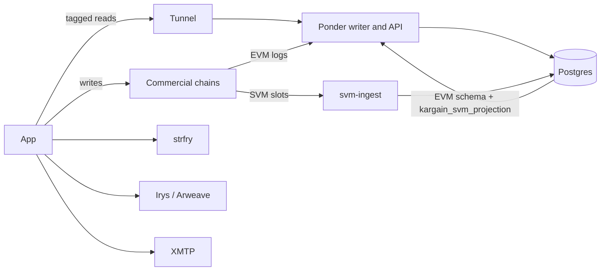

# Architecture overview

Public map of services, truth, and owners. Host names, IPs, users, and server paths stay with the maintainer. Environment variables live only in [`.env.example`](../../.env.example). Normative contract behaviour is [SPEC Part I](../contracts/SPEC.md#part-i--generation-v2-current); indexing deploy rules are [ADR 0016](../adr/0016-one-writer-schema-per-indexing-identity.md).

## Services

| Surface | Responsibility |
|---------|----------------|
| **App** (Next.js) | UI, session, Server Actions; discovery via the indexer HTTP API; chain RPC for detail reads and writes |
| **Ponder** (`ponder`) | Single EVM writer and Hono HTTP API; one schema per indexing identity (`k_<40 hex>`) baked into the writer image; HTTP also unions EVM tables with `kargain_svm_projection` from Postgres |
| **Ponder deploy** (`ponder-deploy`) | Profile-only one-off; builds and switches the writer tag; not a long-running service |
| **Postgres** | Shared database: Ponder writer schema, `kargain_svm_raw`, `kargain_svm_projection` |
| **svm-ingest** | Solana raw ingest into `kargain_svm_raw`; projection is rebuilt by replay, never by dropping raw |
| **strfry** | Nostr relay (kinds the product publishes and reads) |
| **Tunnel** | Edge front for the writer HTTP port; Compose target remains `http://ponder:42069` |
| **Storage** | Arweave via Irys — client-side upload; the user wallet pays; deposit owned by `lib/storage/irys-deposit.ts` |
| **Messaging** | XMTP private sessions; product door `lib/messaging/session-registry.ts` |

Commercial addresses, SVM program ids, and start cursors come only from [`lib/web3/commercial-active.ts`](../../lib/web3/commercial-active.ts). There is no nginx front, no blue/green writer slots, and no views schema over writers ([ADR 0016](../adr/0016-one-writer-schema-per-indexing-identity.md)).

## Truth layers

1. **Chain is authority.** A user write is settled when there is a receipt (and a successful chain read when the UI needs it). Indexer catch-up is not settlement.
2. **Indexers are projections.** Browse, directories, and notifications read Ponder as eventual views: EVM rows from the writer schema, Solana rows from `kargain_svm_projection` (same Postgres, served by the Ponder HTTP API in union with EVM).
3. **Tagged app→indexer reads.** Mutable Ponder projections go through [`lib/web3/ponder-tagged-read.ts`](../../lib/web3/ponder-tagged-read.ts). Wait instruments (`/status`, live passport catch-up) stay uncached.
4. **One post-write refresh owner.** [`hooks/use-tx-sync.ts`](../../hooks/use-tx-sync.ts) (`syncReads`) invalidates indexer tags, client caches, and `router.refresh()`.

Trust does not survive a bridge crossing ([SPEC §I.12](../contracts/SPEC.md#i12-multi-chain-architecture-normative)). Custody: one usable copy on one network.

## Write path (UI → chain → indexer → UI)

1. Session / wallet state from [`lib/web3/active-account.ts`](../../lib/web3/active-account.ts).
2. Write planning and send through the VM write owners; lifecycle and outcomes through `useTxSync` / `runTx`.
3. Chain confirms the transaction.
4. Ponder indexes EVM logs into the writer schema; `svm-ingest` appends Solana raw and projects into `kargain_svm_projection`.
5. `syncReads` refreshes tagged indexer reads and the route; discovery UIs then show the new projection (EVM and SVM via the Ponder API).

## Owners

Area owners (wallet, writes, reads, registry, passport, custody, storage, messaging, bridge, geo, Nostr) are listed once in [`AGENTS.md`](../../AGENTS.md#choke-points). The executable registry is [`lib/architecture/chokepoints.ts`](../../lib/architecture/chokepoints.ts). Product code does not fork by VM in `app/`, `components/`, or `hooks/` — the fork lives in the owner.

Service → runtime owner (not duplicated in the AGENTS table):

| Service | Runtime owner |
|---------|----------------|
| Ponder writer / HTTP | `src/` + `ponder.config.ts` (schema via image `DATABASE_SCHEMA`) |
| svm-ingest | `svm-ingest/svm-raw-writer.ts` |
| strfry | Compose `strfry` + Dockerfile.strfry |
| Tunnel | Compose `cloudflared` (fronts `ponder:42069`) |

The product key is the commercial namespace, never `chainId` alone. Further depth: [indexer README](../indexer/README.md), [design spec](../design-spec.md), [ADRs](../adr/README.md).
